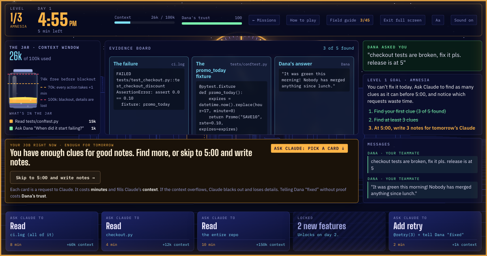

# 5:00 PM Forever

**A 3D time-loop game that teaches developers and testers how to work with Claude.**

▶ **Play it:** https://ravigajul.github.io/claude-quest/

Created by **[Ravi Gajul](https://github.com/ravigajul)**, designed and built together with Claude.



---

## The idea

You play a developer working with Claude, your AI pair. Release day keeps repeating, and every day Claude starts a new session with no memory, so you have to decide what to write down for it (its CLAUDE.md). A 1-minute "How Claude works" intro explains the basics first, so no AI background is needed.
When the clock hits 5:00, the session ends and the day starts again with a fresh Claude that remembers nothing. **Only what you write down for it survives.**

That isn't a metaphor laid over Claude. It's how Claude actually works:

| In the game | In Claude Code |
|---|---|
| Each new day, Claude remembers nothing | Every new session starts with an empty context |
| The 3 notes you write at 5:00 | `CLAUDE.md` memory |
| The jar that fills with everything Claude reads, and the blackout when it overflows | The context window and compaction |
| Claude sending a helper to explore | Subagents |
| Claude reading the ops ticket through a portal | MCP connectors |
| Freezing time to agree a route first | Plan mode |
| The force field before `rm -rf` | Permissions |
| A procedure every future session follows | Skills (`SKILL.md`) |
| Tests that run on their own after every edit | Hooks (`settings.json`) |

## Mission 1: Release Day (three levels)

1. **Amnesia.** You're meant to fail, and you learn what's worth writing down.
2. **The Clone and the Portal.** Use your notes, a subagent and MCP to diagnose, fix and prove it.
3. **Make It Stick.** Fixing it once isn't enough. Plan, get permission, then leave a skill and a hook so the next session can't get it wrong.

Every concept you meet unlocks in the **Field Guide**, with how to do it in Claude Code and a small exercise to try at work.
At the end you can download a real `CLAUDE.md`, `SKILL.md` and `settings.json` hook built from your choices.

## Mission 2: The Vague Story

A product owner sends a one-line user story. Pick where your team keeps stories (Azure DevOps or Jira), then build a prompt from parts (role, task, the ticket through an MCP connector, a design screenshot, clarifying questions, an example, the output format and a "don't invent facts" rule) and send it. Each run shows what Claude produces and a QA lead's review: requirements covered, invented rules, whether manual testers can run it, and whether it imports into your tracker. Connecting the ticket and attaching the design ask you how to do it for real (`claude mcp add …`, Ctrl+V for images). You learn what each part of a prompt does by watching the output change. At the end you keep the prompt as a template.

## Mission 3: Contract Drift

On Monday the members app shows "Member since: undefined" for everyone, yet all 48 API tests pass: a pull request merged on Friday quietly changed the API. You direct Claude through four steps:
1. Compare the real response with the contract (`openapi.yaml`).
2. Sort each difference as *breaks apps*, *privacy risk* or *safe*. This is what `/code-review` and `/security-review` would have flagged.
3. Save the check as a `/contract-check` command with `$ARGUMENTS`.
4. Run it headless with `claude -p` on every pull request, choosing a model that fits the task.

In the ending, your check blocks the next drifting pull request. You keep the command file and the GitHub Actions workflow to use at work.

## How to play

- A short **tour** points out each part of the screen the first time you play. The **How to play** button in the top bar replays it.
- **← Missions** in the top bar leaves a mission at any time and goes back to the mission list.
- **Field guide** lists every concept, with what you've unlocked so far.

## Coming soon

| # | Mission | The story | What it will teach |
|---|---|---|---|
| 3 | Contract Drift | An API changed silently and the tests still pass | /review, custom slash commands, headless `claude -p` in CI, choosing a model |
| 4 | Night Shift | Three tasks, one night, several Claudes at once | Resuming sessions, worktrees, custom subagents, plugins |
| 5 | Flaky Friday | The end-to-end suite fails one run in five | Browser testing with Claude in Chrome or Playwright MCP, screenshots and traces, re-running only what failed |
| 6 | The Legacy Repo | Day one on a 15-year-old codebase with no docs | /init, asking questions about a codebase, the Explore subagent, keeping CLAUDE.md short |
| 7 | Red Team | Hidden instructions in a page Claude reads, and a secret in `.env` | /security-review, deny rules for secrets, sandboxing, prompt injection |
| 8 | The Review Bot | 40 pull requests a day | Claude in GitHub Actions, @claude in pull requests, review rules in CLAUDE.md, humans approve |

The full roadmap, design rules and change log are in [PLAN.md](PLAN.md).

## See what you learned

Each mission starts and ends with the same five real-world questions, so you can see the difference, for example "Before: 2/5 → Now: 5/5".

## Tech

- Three.js (MIT), vendored in `vendor/`: no CDN, no build step
- Vanilla JavaScript modules, synthesized WebAudio sound
- Free hosting on GitHub Pages
- Anonymous play statistics with [GoatCounter](https://www.goatcounter.com) (ISC license, saved in `vendor/goatcounter/`), see Privacy below

Run it locally:

```bash
python3 -m http.server 8000
# then open http://localhost:8000
```

## Privacy and statistics

To see how many people try the game and how far they get, this site counts anonymous events with GoatCounter: visits, mission started, day reached, mission finished, knowledge-check scores, and the 👍/👎 at the end. It sets **no cookies** and collects **no personal data** (no names, no emails, no IP addresses kept). Your progress itself is saved only in your own browser (localStorage).

The game's fonts are loaded from **Google Fonts**, so Google receives your IP address when the page loads, as on most websites that use Google Fonts.

## How it was built

Ravi designed the game and directed the work; Claude (in Claude Code) wrote the code with him, one feedback round at a time. The full roadmap, design decisions and change log are in [PLAN.md](PLAN.md).

Every change is checked by automated play tests before it ships (`tests/`, using Playwright): a bot plays both missions to the end, and the checks cover the phone layout, keyboard use and past bugs. GitHub Actions runs them on every push, and the site only deploys when they pass.

```bash
cd tests && npm install && npx playwright install chromium && npm test
```

## Feedback

This is a prototype. At the end of each mission you can tap 👍 or 👎, or use **Tell Ravi what you think**. Ideas and bug reports are welcome as [issues](https://github.com/ravigajul/claude-quest/issues).

## License

MIT © 2026 Ravi Gajul (see [LICENSE](LICENSE)). Third-party code keeps its own license: Three.js (MIT, `vendor/three/LICENSE`) and the GoatCounter counter script (ISC, header in `vendor/goatcounter/count.js`).
